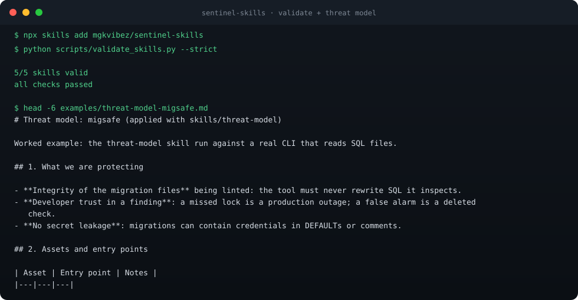

# sentinel-skills

**Five defensive security playbooks for coding agents.** Threat-model a repo, triage an alert, review a diff, research a CVE, harden a service — the way a careful security engineer does it, not the way a confident model improvises.

[](https://github.com/mgkvibez/sentinel-skills/actions/workflows/validate.yml)
[](LICENSE)
[](https://github.com/mgkvibez/sentinel-skills/stargazers)



## Install

```bash
npx skills add mgkvibez/sentinel-skills   # requires Node 22.20 or newer
```

## Three ways to use it

```bash
# 1. Threat-model a repo before you ship it
> use the threat-model skill on this repository

# 2. Review a diff for injection, authz, and secret-handling bugs
> review-diff-for-vulns on the staged changes

# 3. Turn a scanner alert into a decision, not a panic
> triage-alert: semgrep says "unsanitized-input" at api/search.py:44
```

Real worked output: [`examples/threat-model-migsafe.md`](examples/threat-model-migsafe.md) is the threat-model skill applied to a real CLI, including what the model does *not* cover.

## The five skills

| Skill | Use it when |
|---|---|
| `threat-model` | designing or auditing a service, before code review |
| `triage-alert` | a scanner or SIEM fired and you need a verdict |
| `review-diff-for-vulns` | a PR touches auth, input parsing, crypto, or file paths |
| `cve-research` | a dependency CVE lands in your inbox |
| `harden-service` | shipping anything that listens on a port |

## Why it exists

Offensive agent skills exist. Defensive ones mostly don't, so agents default to guessing: they invent severity, skip the asset inventory, and call things "safe" after a regex pass. These playbooks force the boring steps that catch real bugs — name the asset, name the attacker, name the control, then decide.

Every skill ends in a written artifact you can attach to a PR or an incident. Findings are labelled **"no issues found by ruleset v1"** rather than "safe" — a rule pass is evidence, not proof.

## How it works

Each skill is one folder under `skills/` with a `SKILL.md`:

- YAML frontmatter (`name`, `description`) so the agent can route on intent
- `## When to use` / `## Procedure` / `## Rules` / `## Output format`
- a final verification step, so the agent checks its own artifact before returning

`scripts/validate_skills.py` enforces the parts that silently break discovery: frontmatter parses, folder name matches skill name, description length, required sections, minimum substance, and manifest parity with `skills.json`. CI runs it with `--strict` on every push, so a malformed skill never lands.

## Contributing

Read [CONTRIBUTING.md](CONTRIBUTING.md). Run the checks first:

```bash
python3 scripts/validate_skills.py --strict
```

## License

MIT. See [LICENSE](LICENSE).
